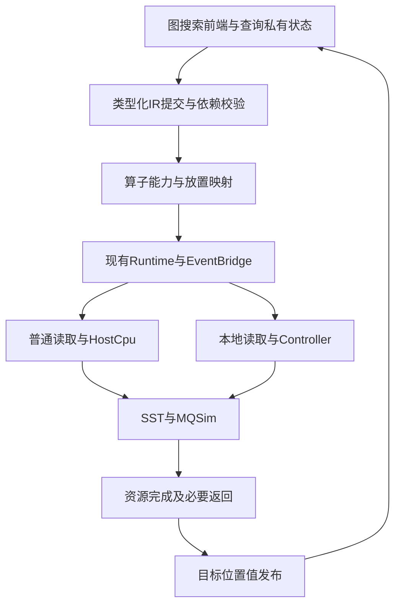

# V0.3 工作负载 IR 设计规范

日期：2026-11-02（Asia/Shanghai）  
契约标识：`ndpsim-ir/1`  
状态：设计规范；V03-1 的 [C++ 类型、schema 与静态校验](ir-schema-v0.3.md)已实现，V03-2 的[动态依赖、值生命周期与异步 JOIN](ir-lifecycle-v0.3.md)已实现，V03-3 的[算子与 placement 映射](ir-mapping-v0.3.md)已实现；生产图前端和 engine 集成尚未实现。诊断格式不是可独立执行文件。产品范围与验收见 [V0.3 PRD](prd-v0.3.md)。

## 1. 目的与设计取舍

IR 表达逻辑数据对象、操作、类型化值、依赖与功能语义，位于负载前端和既有仿真服务之间。它不记录固定提交时间作为执行依据，不把物理 LBA 当内容身份，不以采集结果代替本次功能计算。

本文件完整保存本版需要的设计，不依赖早期 NSC-IR Word 草案。保留其对象/操作/依赖/功能语义分层，以及布局、放置、成本和存储后端分离原则；相对于早期草案，本版做以下明确取舍：

| 主题 | 本版决定 |
| --- | --- |
| 执行方式 | 动态进程内操作为正式路径；replay/mixed暂不支持 |
| 负载 | 仅现有图ANNS；不加入DiskANN/PQ或Engram |
| 调度 | IR管理依赖，Runtime/EventBridge承接执行；只有SST推进时间 |
| 存储/传输 | 继续现有MQSim，不能另加简单SSD或第二条PCIe计费路径 |
| 算子粒度 | 显式读取、评分及各控制阶段；允许严格定义的读取加L2复合算子 |
| 扩展方式 | 类型和能力目录可演进；仅内置受信实现，不要求动态插件/任意代码加载 |
| 落盘 | manifest及可选诊断操作流；不要求从日志独立回放 |
| 优化 | 不进行自动融合、重排、批次变换、缓存、布局或算法优化 |

## 2. 分层架构与权限



| 层 | 责任 | 不得承担 |
| --- | --- | --- |
| 图前端 | 产生操作、绑定已可见结果、组织下一轮、持有查询私有状态 | 原始文件/mmap访问、直接提交后端读或计算、推进时钟 |
| IR校验/依赖层 | 类型、引用、控制许可、生命周期与操作关联 | 自行伪造服务完成、重复模拟资源队列 |
| 算子目录与映射层 | 选择合法实现，把逻辑操作转换为现有服务及消息 | 隐式改精度、算法、布局或省略传输 |
| Runtime/服务适配器 | 私有功能结果、资源服务、返回和发布门控 | 将私有结果提前交前端 |
| Content/Layout/Handles | 真实内容、LBA映射、位置权限与版本 | 把宿主页缓存命中解释为模拟cache hit |
| SST/MQSim | 原有时间、存储和PCIe资源 | 被IR越过当前SST时间驱动 |

lowering（下文称“映射”）表示把一个逻辑操作转换为一组现有执行步骤。一个 IR op 可以对应多个 Runtime task、读取请求、chunk 和消息；不得强行一一对应而改变原资源/服务粒度。

## 3. 版本与身份

产品V0.3、IR契约`ndpsim-ir/1`、算子语义版本、搜索/成本/布局版本、输入schema、消息wire版本分别记录。引入IR不自动升级旧离线数据或wire格式。

未知IR主版本、未知必需字段语义、未知operator/version、依赖类型或位置均拒绝。扩展信息放入明确的可选`extensions`命名空间；只有声明为非语义元信息的未知扩展可忽略，核心字段拼写错误不能被默默忽略。实现必须输出实际能力目录，而不是把保留枚举全部声明为支持。

Manifest最小内容如下；名称为本版设计基线，正式schema需在实施时与代码共同冻结。

| 字段 | 内容与约束 |
| --- | --- |
| `ir_version` | `ndpsim-ir/1` |
| `execution_engine` / `execution_mode` | `ir` / `dynamic`；direct作为对照另记，不伪造IR执行记录 |
| `workload_type` / `frontend` | `graph_ann`；前端名称、语义版本、源码身份 |
| `dataset` / `index` / `truth` / `queries` | 现有产物身份、哈希、shape、ID映射与顺序；可引用已有manifest |
| `search` | `ndpsim-ranked-expansion-v1`及entry/k/L/B/E/chunk |
| `operator_set` | 使用的operator/version及能力目录hash |
| `mapping` | host/controller、映射策略版本、布局、profile、初态与成本配置身份 |
| `execution_scope` | run、query；迭代/语义批次归属规则；原始query ID与运行序号分开 |
| `source` / `dependencies` | 主仓、实际源码、MQSim/SST、工具链和未提交改动身份 |
| `diagnostics` | statistics/detail、日志schema与预算；不作为模拟成本参数 |

旧输入哈希相同不足以复用运行；engine/IR/算子/映射/模型/配置/依赖任何执行相关身份变化均使该运行缓存失效。

## 4. 对象、值与操作

### 4.1 DataObject

对象表示逻辑记录集合；元素ID与对象集合ID不同。例如`base_vectors`是一个对象，向量201是其中一个元素，而不是建立一百万个字符串对象描述。

| 字段 | 约束 |
| --- | --- |
| `object_id` | run内稳定的逻辑集合标识；不含地址/裸指针 |
| `object_type` | 本版注册query_vectors、base_vectors、adjacency；扩展名不等于支持 |
| `content_identity` | dataset/index身份、内容版本及hash |
| `element_count` | uint64描述；当前后端节点ID仍受uint32范围限制，超出明确拒绝 |
| `element_type` / `shape` | fp32向量或uint32邻接等；维度、字节序固定 |
| `record_schema` | 字段和逻辑长度；邻接保留degree及有效IDs，固定槽padding另述 |
| `logical_layout` | 元素/字段寻址规则，不能携带PPA当逻辑地址 |
| `mutability` | 本版数据对象仅readonly |
| `content_ref` | 已校验文件/内存内容提供者；仅受信后端可打开 |

驻留`HostMemory/DeviceBuffer/SSDStorage`属于值能力和映射结果，不由DataObject授予。对象在宿主存在不等于模拟主机可读。物理布局继续使用既有公式；默认不增加行合并、跨批缓存或紧凑共置。

### 4.2 ValueRef与类型

输入必须用带类型的引用，不能只给无作用域的字符串名称。

| 引用类型 | 内容 | 含义 |
| --- | --- | --- |
| `object_slice` | object_id、content_version、indices或indices_ref、field/range | 逻辑选择描述，不等于已经读回的值 |
| `op_output` | producer_op、port、type | 已提交操作的特定输出；可Pending，Visible后才能消费 |
| `literal` | type、value | 小型配置常量/入口ID等；不得塞入预计算距离或完整后继trace |
| `state_ref` | query、state_id、version、type | 查询私有搜索状态的不可变视图或排他所有权令牌 |

基本类型至少包含`u32/u64/bool`、`ids_u32[n]`、`fp32[d]`、`scores_id_f64[n]`、带有效长度的邻接记录和不透明查询状态。运行期长度用可校验的动态shape，不能跳过实际长度检查。得分仍为uint32 ID加binary64 distance，每项12B；拒绝非有限距离。

`object_slice`包含地址选择，不能隐式当`DATA`满足；实际读取/评分映射才获得内容能力。`op_output`的数值和目标位置由生产者声明并经发布门控；前端仅有HostMemory可读权限。初次MERGE的`previous`可使用固定零长度`scores_id_f64[0]`、值为`[]`的literal；只允许此空历史初始化，不允许非空得分或用于其他端口。literal不产生目标硬件加载豁免，query上传仍由原协议计费。

每个输出端口单次定义。旧状态版本可能仍被在途操作持有，不能原地覆盖；可用移动所有权/共享不可变块/按需快照，禁止为此永久保存全部迭代状态。动态状态值不伪装为可写持久化DataObject；在线索引写入仍Unsupported。

### 4.3 Operation

| 字段 | 必需性与规则 |
| --- | --- |
| `op_id` | 必需；run内uint64单调、非0、不复用，溢出拒绝 |
| `scope` | 必需；query、iteration、semantic_batch，必要时chunk/阶段；不以宿主指针为ID |
| `kind` / `operator` / `operator_version` | 必需；目录中合法组合 |
| `inputs` / `outputs` | 必需，可为空；端口名、类型、shape和输出目标位置明确 |
| `deps` | 必需，可为空；producer_op、依赖类型及端口/状态版本绑定 |
| `access` | 访问数据对象的操作必需；对象切片、只读、批次内顺序、动态地址引用 |
| `params` | 算子参数；不得覆盖已冻结的搜索/数值语义 |
| `workload` | 对有目标计算成本的COMPUTE/CONTROL必需指定规则；动态计数在受信evaluate后填写实际Work |
| `effects` | 必需；纯值/逻辑读/查询状态转换等已注册效果，不能隐藏I/O |
| `schedule` | 可选诊断分组；本版不支持改变priority、预取或任意重排 |
| `provenance` | 可选；源操作、记录偏移、墙钟采样；不能控制模拟提交时间 |

五类顶层Kind为`MEMORY/COMPUTE/CONTROL/SYNC/EXTERNAL`。本版只实现第6节的算子集合；保留类别不代表WRITE、HASH、PQ、任意BRANCH、ARRIVAL或OPAQUE_KERNEL已经可执行。可选`parallel_group`只用于说明，不能代替真实依赖。

workload沿用`elements/flops/read_bytes/write_bytes/output_bytes/candidate_checks/comparisons`。逻辑字节不包含sector padding、NAND和PCIe计费。动态工作量由真实受信功能函数产生一次，再用于原服务公式；前端不能通过填写更小的计数缩短服务。静态shape上界用于预留，实际工作量/输出不得超过合法上界；两者不可混为已完成结果。

## 5. 依赖与动态生成

| 依赖 | 满足条件 | 本版例子 |
| --- | --- | --- |
| ADDRESS | 索引端口已在地址使用者合法位置Visible，类型/范围通过 | SELECT的IDs决定READ，DEDUP的IDs决定评分 |
| DATA | 指定值已在消费者目标位置Visible | 邻接READ结果供DEDUP，得分供MERGE |
| CONTROL | 产生/允许该操作的决策或查询令牌成功可见 | QUERY_READY触发入口评分，SELECT非空才创建邻接读取 |
| ORDER | 指定前序操作的完成令牌/状态版本可见 | 同一query状态转换先后；不额外传输数据 |

所有必需边为AND关系；端口引用和deps须一致，缺失ADDRESS/DATA边不能仅凭“数据在宿主内存里”绕过检查。ORDER不能代替真正的地址或数据依赖。同一生产者可提供不同语义的边；不因此重复执行或重复计费。

本版采用增量、只引用已提交生产者的DAG：允许引用尚未完成的已提交操作，不允许未来op、自引用或循环引用。单调分配和引用规则使运行图无环；非法前向引用在接纳时拒绝，不等待形成停滞。诊断文件校验按同样规则处理，并检查缺失端口/依赖。无需支持任意顺序文件的全图拓扑整理。

循环由前端在可见结果回调中生成下一批新ID操作；只生成实际被选中的分支，不预建未选中分支，也不需要通用Skipped/Phi语义。SELECT为空时直接产生合法查询终态，禁止继续读；任一输入失败则不能按成功分支展开。

语义就绪可写为：`依赖满足 ∧ 输入位置/类型合法 ∧ 控制许可`。资源获准及实际完成由原服务决定；IR不能只按`dispatch + 一个总cost`伪造整条I/O完成。资源不足保留有界待执行状态/背压，不改变搜索批次、分块或FIFO顺序。

## 6. V0.3最小算子与映射

### 6.1 内置目录

| Kind / operator | 输入与输出 | 执行/成本边界 |
| --- | --- | --- |
| EXTERNAL / QUERY_READY | 已接纳query与初始状态 → query/控制令牌 | 继承原接纳时刻及初始HostMemory语义；不是新增在线到达模型 |
| MEMORY / READ_ADJACENCY | 对象切片及IDs → 有效邻接记录 | 原普通读取，所有extents与DMA/CQ完成后HostMemory可见；每节点提交顺序不变 |
| COMPUTE / SCORE_L2 | query、向量逻辑切片及IDs → 同输入顺序得分 | 显式读取加L2的复合算子；见6.2，不是任意纯算术L2 |
| CONTROL / MERGE_CANDIDATES | 旧全体得分、本批所有得分 → 新全体有序得分 | 原candidates函数及其checks/comparisons/字节；仍为一次对应主机控制服务 |
| CONTROL / SELECT_FRONTIER | 有序得分、expanded、配置 → 选中IDs | 原前L扫描、B/E限制及candidate_checks；HostCpu服务后发布 |
| CONTROL / DEDUP_NEIGHBORS | 本批全部邻接、scored快照 → 升序新IDs | 原逐边check、显式线性比较/插入规则；不得换hash/heap但沿用旧成本 |
| SYNC / JOIN | 指定端口集合 → 完成令牌或有序结果集合 | 原when_all语义，不新增目标服务；零时长也异步 |

各operator从版本1开始。READ_ADJACENCY可通过注册记录解码器实现，SCORE_L2是明确的领域复合操作；本版不宣称已证明任意负载通用性。主机上的纯L2功能函数可继续内部复用，不必强行为每次向量读新增外部IR操作再重复一次评分读取。

MERGE隐含等待完整语义评分批次，DEDUP隐含等待完整邻接批次；实现可用JOIN或输入依赖集合表达，不能两个都添加独立计费服务。SELECT空输出即停止判据，不额外调用一个收费LOOP_CHECK改变原模拟时间。

### 6.2 SCORE_L2的复合语义

该算子声明`effects=logical_read`，`access`列出所需向量，输出真实评分；读取是公开效果，不允许藏在任意callback中。它不要求前端先把向量读到HostMemory。其映射必须满足：

| placement | 映射步骤 |
| --- | --- |
| host | 按原search.chunk切块；逐块按原顺序提交各向量普通读；输入到HostMemory后提交原HostCpu距离服务；各块结果就绪供原单次MERGE消费 |
| controller | 保留query会话Open及实际上传；使用原Controller::score选择集合，原buffer/容量规则确定chunk；本地读、staging、L2、结果写回/读出、实际PCIe返回；所有chunk按输入顺序汇合后才向主机发布语义批次 |

主机搜索chunk与盘控受容量约束的chunk规则分别继承，不能强迫两边底层块完全相同。若host内部存在多块结果，IR映射须保持原每块距离服务与合并的依赖/提交时刻；不得把全部读取统一等待后才启动所有块计算。逻辑操作存在不等于整个操作只占一个资源slot。

query上传只按原会话执行一次，Close等待原已提交chunk和回复排空；Open/Close可为映射层生成的服务事件，必须有query/IR生命周期关联及真实费用。不能每次SCORE重新上传query，也不能删掉OpenAck/CloseAck以“保持IR简洁”。会话关闭仍属于查询排空而非提前改变结果可见时刻。

SCORE输出长度12b，FP32输入固定顺序FP64累加，L2为3bd FLOP；公式及舍入沿用现有实现。能力目录必须声明允许的输入位置、输出位置、逻辑读效果、输出/scratch上界、功能实现和成本版本。泛化后不能只有operator名称而没有这些规则。

### 6.3 控制状态与工作量

查询状态包括全体已评分得分、scored、expanded和迭代/批次计数。scored在评分提交时更新，expanded在SELECT可见后、邻接提交前更新，保持原逻辑时点。快照不可被后续修改污染。

原来已经被候选check/比较模型覆盖的集合维护仍由相同成本覆盖；IR不得重复收一次“状态更新成本”。前端可以应用已可见IDs和移动句柄/版本，不能自行进行未计费的距离计算、邻居去重或候选排序。终态top-k切片与诊断序列化沿用原零额外服务口径，不能顺便改变目标CPU模型。

不透明状态引用的版本用于依赖安全，不要求把整个set序列化到Runtime字节数组或wire；状态留主机，不能免费把它交给controller执行控制逻辑。

## 7. 执行、可见性与资源

沿用任务生命周期`Submitted → WaitingDependencies → WaitingResource → Running → ServiceDone → WaitingReturn → Visible`和Failed终态。IR层可维护更少的管理状态，但必须能解释这些实际执行阶段；复合操作的内部子阶段由映射关联记录，不能提前将父操作标Visible。

1. 提交时校验可知的结构、身份与能力，建立输入所有权。
2. 输入/依赖可见后解析动态地址并检查范围、容量及输出上界。
3. 受信适配器向原资源排队；资源获准后才运行一次功能evaluate，所得真实结果保存在私有槽。
4. 按原工作量执行服务。普通读取等待数据DMA与CQ；本地读取等待全部事务、cache服务、安全清理和staging。
5. 主机消费者需要的返回消息及端点处理完成后才发布。完成观察不内联递归恢复前端。
6. 通过ContinueSubmit恢复前端并生成后继操作；收回无引用且已排空的值、任务和映射。

EventBridge继续使用`(time_ns, delta, phase, sequence)`；Backend、ResourceCompleteRelease、Publish、ContinueSubmit四阶段顺序、同phase FIFO和回绕规则保持。管理层不得以墙钟、外部采集时间或人为1ns推进搜索；额外管理callback也不得改变同刻实际资源的提交仲裁顺序。

底层唯一计费者保持如下：MQSim负责NAND/FTL/ONFI/cache/CMT/PCIe；HostCpu负责原距离/控制；Controller负责原算术及独立缓冲staging/credit。主机距离rate已经包含加载，盘控算术rate不含缓冲服务。IR的workload字节用于解释功能工作，不再单独叠加一条带宽模型。

容量不足按原BufferModel等待；单请求不可容纳立即拒绝。输入/输出/scratch预留和释放继续使用原Controller规则。不得用逻辑有效字节代替sector覆盖预留，或在返回到达前释放仍在使用的结果缓冲。保留至少一个确定性工作块前进空间。

## 8. 错误与生命周期

校验分两段：结构/版本/位置等静态错误在接纳前拒绝，动态地址/长度错误在该操作提交任何实际后端请求或credit前拒绝。复合批次全量合法性检查后才进入真实副作用阶段，不能部分发出后再报告输入非法。运行期间真实失败按现行安全排空边界处理；不可恢复后端失败终止实验。

错误至少携带原有code、query、IR op、相关value/producer、时间、cause和detail；根因不能被统一包装成无上下文的“执行失败”。NotReady不是失败，重复完成/释放、错误位置、版本不符、越界和Unsupported必须能诊断。资源耗尽/停滞诊断包含当前依赖与等待资源。

每个value/状态视图由调用者和在途消费者显式持有；前端释放不影响已经提交的消费者。完成、发布和回调排空前不得回收。操作完成后无引用/等待/在途事件才释放；累计计数、流式摘要和必要终态结果可保留，全部历史操作和依赖边不可保留为常驻默认结构。

旧输出引用在回收后不可重新建立消费关系；前端需在消费前持有合法引用，不能拿历史op_id复活值。诊断日志是不可用于执行的历史证据，不具备读取权限。

## 9. 单查询动态样例

下面是结构化伪流程，不是可直接运行的JSON或新的算法。各箭头必须由真实可见结果驱动；每次迭代重新分配op_id。

```text
QUERY_READY(query, initial_state)
  → SCORE_L2(query, base_vectors[entry])
  → MERGE_CANDIDATES(empty_scores, complete_score_batch)
  → SELECT_FRONTIER(all_scores, expanded, L/B/E)
      if selected_ids is empty:
          publish original top-k result; drain/close using existing rules
      else:
          update expanded using visible selected_ids
          → READ_ADJACENCY(adjacency[selected_ids])
          → DEDUP_NEIGHBORS(all_adjacency_results, scored_snapshot)
              if fresh_ids is empty:
                  continue SELECT with original state-update rules
              else:
                  update scored at score submission
                  → SCORE_L2(query, base_vectors[fresh_ids])
                  → MERGE_CANDIDATES(all_scores, complete_score_batch)
                  → next SELECT
```

例如`op21=SELECT_FRONTIER`的`ids`端口绑定`op22=READ_ADJACENCY`的`access.indices_ref`，并带`ADDRESS(op21, ids)`；同一SELECT可见成功也提供控制许可。`op23=DEDUP_NEIGHBORS`等待op22全部有效邻接的DATA及正确scored版本；`op24=SCORE_L2`通过ADDRESS绑定op23的fresh_ids，并通过DATA绑定query。query已经在主机可见不等于盘控Open已完成，后者由评分映射内部继续等待。

如果实现把邻接批拆成每节点多个MEMORY操作，DEDUP必须等待整个语义批次；如果评分拆成多个Runtime任务，MERGE仍只执行原次数。所有拆分都有父op和稳定批次关联，不能改变原提交和汇合语义。

## 10. 诊断文件与比较

推荐输出`ir-manifest.json`、可选`ir-operations.jsonl`及`ir-bindings.jsonl`；名称在实现阶段冻结。进程内提交不要求先序列化再解析。操作流记录结构、端口、依赖、scope和状态转换；大内容只记录身份/shape/hash或受限样本，不复制base与全部中间值。

这些文件用于校验和追踪，首版不保证可回放；缺少完整输入内容或动态前端状态时不能标为“可独立执行IR包”。既有底层事件日志继续使用，bindings连接IR父操作与服务/请求/消息。导出有预算、流式写入和失败诊断，关闭后不保留隐性全历史副本。

比较键推荐`原query ID + iteration + semantic_batch + operator角色 + 块/元素序号`，再关联到资源事件；不要直接比较不同engine的数值op/task ID。规范化规则必须版本化并逐字段说明可排除内容；时间、字节、控制工作量、FIFO仲裁和服务阶段不能被排除。完整要求以 [PRD第7节](prd-v0.3.md#7-等价性的精确定义)为准。

## 11. 实现边界与测试重点

现有代码可复用：[Runtime](../src/runtime/runtime.h)、[EventBridge](../src/backend/event_bridge.h)、[Content/Handles/Layout](../src/content/content.h)、[HostCpu](../src/model/host_cpu.h)、[Controller](../src/model/controller.h)、[功能算子](../src/operators/operators.h)。[GraphSearch](../src/search/graph.cc)和[组件接线](../src/sst/graph_host.cc)是迁移与旁路审计重点。链接说明基线位置，不承诺未来文件划分或现成通用API。

至少需要：结构与非法引用测试、运行时动态越界拒绝、类型与状态版本、真实值改变后继、三阶段延迟扰动、空依赖异步、跨页/多chunk汇合、同刻仲裁、错误后不产生后继、credit与会话排空、生命周期ASan、Q梯度、statistics/detail等价、小规模四组合以及完整SIFT矩阵。机器可读schema必须与内存结构和诊断输出一致，不能各自演进。

迁移首先保留行为。若抽象要求改变原提交顺序或控制服务数，应调整抽象/映射，不能先改模型再放宽等价标准。后续扩展的通用WRITE、COPY、缓存、额外位置与多负载能力须另立需求和验证，不包含在本版通过结论中。
