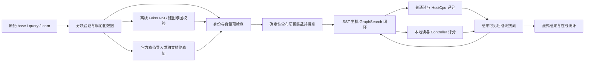

# V0.2 源码核查与实施规划

日期：2026-10-30（Asia/Shanghai）。状态：当前 V0.2 开发执行计划，按用户启动 V0.2 开发的要求启用。默认方案作为实施起点，待核实项和阶段出口继续有效；规划本身不代表通过，实际任务状态及证据见第 0 节。原规划轮仅做文档与探针的工作范围不再限制后续开发；不自动提交、推送、升级或初始化依赖。

依据：README、V0.1 交接、现行架构/契约/搜索/扩展/测试/限制文档，以及 [V0.2 PRD](prd-v0.2.md) 第 9 节。核查主仓 HEAD 为 `9f58946ef5214bcd1c6ef40a5fd39ef36cd621b0`，含用户已有暂存修改；不能只以 HEAD 代表本次文档和工具身份。MQSim gitlink 为 `8f7ddf6d8cafdb7c783b3fcfd4693f15c6c5854b`，SST 为 `ffd71527bc26a1f2a4fb685fdeb2ca0799997d78`。

## 0. 开工入口与进度维护

下一轮直接执行本计划，不再从“V0.2 范围未定”开始需求分析。先核对工作区、子模块与已有证据身份，保留用户已有变更；本页源码核查和探针均为规划时快照，不能代替当前检出验证。

当前进度：**T0/M0 前置实证已收口**，详见 [M0 实证与接续](m0-closeout.md) 和本机 `results/v0.2-m0/{manifest.json,assertions.json}`；64 项证据核对通过。T1 数据与 schema 已完成（见 [T1 收口](t1-closeout.md)）；T2 图与真值已完成（见 [T2 收口](t2-closeout.md)）；T3/M1 闭环已完成（见 [T3 收口](t3-closeout.md)）；T4/M2 内容与 profile 已完成（见 [T4 收口](t4-closeout.md)）；T5/M2 观测与生命周期已完成（见 [T5 收口](t5-closeout.md)）；T6/M2 完整 SIFT1M 已完成（见 [T6 收口](t6-closeout.md)），T7/T8 尚未开始；不把准备探针或 T4 小布局运行计为规模查询验收。

1. **T0 数据/依赖身份已完成**：六个完整原始文件通过头部/长度/有限值/ID 校验并锁定 SHA256；SIFT 官方 FTP 归档与官方 MD5 一致，Deep 为官方独立 10M 文件。数据使用条件与未发现独立数据许可证的事实写入 `configs/benchmarks/datasets.lock.json`。Faiss 1.12.0 完整 commit、OpenMP/LLVM CMake 源码包与系统工具链身份见 `m0-builder.lock.json`，离线构建入口实跑通过。
2. **T0 资源证据及预算已完成**：本机 RAM=16 GiB；两维度 10k/100k/1M 建图各三次及单线程小图通过；2/16 GiB 探针几何各三档初始化与两种目标布局各三次排空通过。预算、质量门槛及正式查询 ID 已冻结。Deep 32 GiB 建图预算高于本机 60% RAM 上限，完整 10M 建图仍保留 M3 资源门槛；不自动减小 N 或放宽门槛。
3. **按第 6 节依赖继续**：数据身份关闭后可推进 T1，建图验证关闭后推进 T2，再做 T3 小规模闭环；T4/T5 在全规模运行前完成，T6 SIFT1M 通过后推进 T7 Deep10M，最后 T8 交付。只阻塞依赖未满足的任务，继续其余可执行工作。
4. **维护可接续记录**：每次完成任务后，在本节更新任务状态、实际改动、证据路径、命令/退出码/断言、未决项和下一任务；实现后同步对应接口、契约、测试和限制文档。未运行的测试标记未执行，缺失的本机证据不能当成可随 Git 检出取得的产物。

本轮任务清单：

- [x] T0/M0：工作区/子模块核对、原始数据内容锁、建图依赖锁及本机导出、资源/初始化实测、预算冻结；根 CMake 配置/编译、CTest 53/53、M0 工具五类测试、`SST_ROOT` 复用配置下的 M0 测试和 64 项证据断言通过。MQSim/SST 子模块未修改；完整 AC、原生 oracle、ASan 本轮未执行。
- [x] T1/M1：正式数据导入与 schema；四格式及错误夹具、v1 兼容、锁定 SIFT 完整源扫描后小选行通过；根配置/编译及 CTest 54/54。证据与限制见 [T1 收口](t1-closeout.md)，M1 整体未完成。
- [x] T2/M1：正式 NSG 图导出、index-v1/truth-v2 身份与校验、独立有界内存 FP64 真值、官方 SIFT ID-only 和双质量指标；真实 SIFT 10k 重排子集与 32 条诊断 query 通过，完整 base 官方 K=100 导入通过；CTest 55/55。证据、命令与限制见 [T2 收口](t2-closeout.md)，M1 整体尚未完成。
- [x] T3/M1：dataset-v2/index-v1/truth-v2 正式接线、搜索/成本/布局元数据、双质量输出与独立对照；真实 SIFT 10k/32 query 原始及向量扰动两放置通过，逐批决策/距离/流量和后续读取改变通过，CTest 56/56。见 [T3 收口](t3-closeout.md)；M1 小规模出口完成，非全规模验收。
- [x] T4/M2：默认只读 mmap/保留 memory、公式布局、受控 2/16 GiB profile、静态资源与实际 namespace/credit 检查；真实 SIFT 10k/32 query 和 d128/d96/d260 两后端两放置事件/结果/模拟统计等价；CTest 64/64、完整 V0.1 AC-01～11、独立原生 oracle、17项既有及1项映射 ASan通过。证据与限制见 [T4 收口](t4-closeout.md)，M2 全规模出口未完成。
- [x] T5/M2：终态任务/lease/消息回收，资源流式输出、SSD区间外排序和磁盘分组后处理、决策摘要/生命周期计数/预算/RSS；66/66 CTest、Q32/128/512两放置三次重复、detail/statistics等价及真实SIFT10k独立对照通过。完整V0.1 AC-01～11、独立锁定原生oracle、17项既有和2项专项ASan通过。实际证据和限制见 [T5 收口](t5-closeout.md)。
- [x] T6/M2：完整1M真实NSG图、官方匹配真值和固定查询身份；26次放置运行、四点扫描、重复/并发/detail对照、1,066批独立核对及473条断言通过，完整布局初始化和冻结资源预算通过；最终67/67 CTest、完整V0.1 AC-01～11、锁定原生oracle、17项ASan。初轮后处理RSS拒绝已以流式核对和严格逐项复用恢复，证据与限制见 [T6 收口](t6-closeout.md)。
- [ ] T7/M3：完整 Deep10M 实验矩阵；另有全量建图资源门槛。
- [ ] T8/M4：交付。

当前后续任务：T7/M3，**本轮到 T6 为止，不自动开始下一任务**。T6使用已实现的verify_t6.py；第7节其余统一CLI仍待实现，使用前检查是否存在；T0 实跑入口为 `tools/verify_m0.py` 和 `tools/m0/`。旧构建与回归入口继续有效，不因本页而自动启动完整规模矩阵。

## 1. 建议架构与决策状态

建议采用“离线标准数据与真实图准备 + 现有闭环搜索 + 可规模化内容后端与观测”的架构。继续单 SSD、应用只读、主机控制、host/controller 两种评分位置；SST 统一时间，MQSim 唯一计费存储和 PCIe。不增加命名算法搜索、紧凑布局、在线到达模型或默认快速初始化。



该图中的离线准备不进入模拟查询时间线；正式搜索不会读取预先计算的访问 trace。下面的方案均须经各阶段出口验证后才能成为现行架构。

| 决策 | 建议 | 当前证据/门槛 |
| --- | --- | --- |
| 搜索 | 命名为 `ndpsim-ranked-expansion-v1`，完整保留现有语义 | T3 已接入正式搜索元数据并以真实小图双放置验证 |
| 建图 | Faiss 1.12.0 CPU `IndexNSGFlat`，NNDescent 建初始 kNN 图 | M0 已验证锁定源码的本机编译/导出与两维度 1M 样本；完整 Deep10M 仍有资源门槛 |
| 内容 | 只读 mmap/分块读取，公式布局，紧凑元数据 | T4 已实现，保留 memory 及受信 Handles/Runtime 门控；T5 已完成生产事件/句柄回收与小规模 Q 梯度验证 |
| 布局 | `independent-sector-v1`，向量与邻接独立 512 B 对齐 | 与现行字节/计费兼容 |
| 初态 | 保留逐页写入、排空、记录 origin；不重置时间 | M0 已测目标布局字节的 SST 探针；正式SIFT1M联合验证已由T6完成，Deep10M待T7 |
| 观测 | statistics 默认，detail 可选；在线聚合与流式文件 | T5 已完成固定块外排序/流式导出及回收，小样本独立并集、Q梯度和日志等价通过 |
| 真值 | SIFT 导入官方 ID；Deep10M 对选定 query 重算 | 不使用 Deep1B 真值过滤代替重算 |

## 2. 源码核查发现及影响

下表保留规划时核查起点；T3 已接通 v2，T4 已替换 native-small-only、全量内容复制及 Placement map 等路径，现行接口见 [T4](t4-content-profiles.md)。其余历史状态不应覆盖第0节实际进度。

| 源码位置 | 已确认行为 | V0.2 处理 |
| --- | --- | --- |
| `tools/ann_data.py`: digest/read_dataset/exact_truth | read_bytes 全文件、Python 浮点行对象；每查询保存 N 个 dict 并完整排序 | 分块校验/哈希；独立精确检索分块 top-K；旧 oracle 保留用于小夹具 |
| `tools/run_graph.py`: run | 仅接受 native-small；truth 必须 k 相等且有距离；600 秒 SST timeout；records 全文读取与解析 | 分版本验证、K≥k 与 ID-only truth；阶段超时配置化；后处理流式化 |
| `src/sst/graph_host.cc`: 构造函数 | 完整 vb/ab 文件与逐对象 bytes 同时存在；每对象解析，构建 placements | 映射后端、分块验证；规则布局避免 O(N) Placement map |
| `src/content/content.h/.cc` | ContentStore 每对象 map/bytes/hash；Layout map；Handles live record 可回收，但 leases tombstone 和 releases 历史保留 | 文件级身份+按需切片；代际句柄/轻量失效状态；保留重复 release 等错误识别 |
| `src/search/graph.cc`: score/select/neighbors | 所有已评分得分保留；前 L 选 B；E 预算；显式线性去重比较；整批评分后合并 | 不悄悄换 heap/hash 而沿用旧控制费；任何改变另设语义/成本版本 |
| `src/runtime/runtime.cc`: collect | 释放 output，但 tasks_ 与 transitions_ 不随完成任务删除 | 安全回收已终止且无所有权/依赖/在途回调任务，不能只检查 live_results |
| `src/sst/graph_host.cc`: retired | 查询完成后延迟擦除 sessions_，避免在回调内析构自身 | 保留已有效的回收机制，重点处理其余历史表 |
| `src/backend/ordinary_device.h` | partition 与 ID 列表硬编码 2 channel × 1 chip × 2 die × 1 plane；page sectors=8 | 单一 profile 描述驱动 XML、partition、页大小、manifest 与容量检查 |
| `src/backend/preload_window.h`: advance | 每次后端排空后提交下一页写入，近似 QD1；完成全部布局才测量 | 先测真实初始化；增加预装载并发也会改变初态，不能当作无语义优化 |
| `src/backend/observation.h` | intervals_ 保留全部区间，report 时分组排序；包括预装载历史 | 单独划分初始化窗口；有序安全归并或流式落盘外排序；不能按回调到达顺序简单累加 |
| HostCpu、Controller、PcieTransport | services/credit/resource/storage/message 记录保留；transport 用 id-1 索引历史 vector | 将在途关联和历史观测分开；不能直接删除 vector 元素破坏关联 |

现行搜索的固定入口先评分，所有得分按 `(FP64 distance, uint32 ID)` 排序；选择前 L 内至多 B 个未扩展节点；整批邻接完成后去重，按 ID 顺序评分；达到 E 或无候选终止，返回全体已评分节点 top-k。图来源为 NSG 时，结果应称“NSG 图 + 项目搜索”，不能称为忠实 NSG/DiskANN 搜索。当前控制工作量随已评分集合增长，可能成为高 Recall 扫描的主要成本；该成本是模型结果的一部分。

## 3. 数据、建图与真值身份

### 3.1 数据来源选择

- SIFT：选择 TexMex 的 ANN_SIFT1M 包，文件为 `sift_base.fvecs`、`sift_query.fvecs`、`sift_learn.fvecs`、`sift_groundtruth.ivecs`；base=1,000,000、d=128，query=10,000、learn=100,000、真值 K=100。规划时页面超时；M0 已从官方 FTP 取得归档，与官方 MD5 一致并验证全部文件，实际 SHA256 和使用条件见 `configs/benchmarks/datasets.lock.json`。HTTPS 证书域名不匹配、HTTP 路径失败均记录，不冒充成功 TLS 获取。
- Deep：选择 Yandex 官方明确发布的 `DEEP/base.10M.fbin` 和 `DEEP/query.public.10K.fbin`，不是自行截取 1B 的前 10M。官方描述 d=96、FP32，源向量已 PCA/l2-normalized；本项目不再次归一化。原始文件内行号就是本实验原始 ID；不推断其在 1B 文件中的 ID 对应关系。
- 两者 canonical base ID 为文件行号 0..N-1，保存 query 原始行号与选取顺序。base 子集必须保存显式映射并重算真值。learn 独立标识；建议 NSGFlat 流程不使用 learn/query 训练建图。
- 原始/规范化文件均保存 SHA256、字节数、行数、维度、类型、字节序、来源 URL、获取时间、使用条件。官方链接不是文件内容身份；M0 已完成两数据集六个原始文件的内容锁，Deep base 实测为 3,840,000,008 B、10M×96 FP32。规范化文件仍待 T1，不能填写不存在的转换后哈希。

### 3.2 建图选择与锁定

M0 使用 **Faiss 1.12.0 CPU NSGFlat**，锁定 commit：`e8234e563f1ecef5f036e83c3cfee366d3f1fbca`。官方该版本安装文档列出 OSX arm64 CPU 包、aarch64 generic 编译选项和 OpenMP/BLAS 要求；主许可证 MIT，保留来源与依赖许可证。使用独立离线程序/进程，不把 Faiss 链入 SST 正式评分路径，避免改变内部 FP64 算子与目标计费。

建议首轮参数：R=64、GK=64、NNDescent 建 kNN、NSG 构建 L=200/C=500；线程数 4，小夹具单线程，记录有效 RNG seed 与算法实际是否接受 seed。显式禁用暴力全量 kNN 构建路径，避免 N² 距离开销。参数是预注册候选，不是已测最优值；若锁定版本不暴露 seed，须记录“不能外设”及实际常量，不制造 seed 参数。

导出入口与逐节点邻接至固定槽 `(degree, IDs[R])`，保留有效邻接顺序、ID 不变；读取负值 sentinel 后验证有效 degree，不静默截断。验证全部节点、入口、ID、度数分布、重复边与从入口有向可达性；建议可达率必须 100%。适配理由：单层图、FP32/L2、单入口和 uint32 邻接能映射现有接口，无需引入 PQ、多层导航或盘内搜索。

替代方案：ZJULearning NSG 官方构建要求 AVX-256，因此不作为 arm64 默认；DiskANN 当前主线为 Rust DiskANN3，不能拿旧 C++ Vamana 教程直接套用。若 Faiss NSG 在 10M 构建超预算，应重新评审有界内存建图方案，不能改用随机图或缩小 base 宣称完成。

M0 已完成锁定 commit 的本机 C++ 编译和图导出，使用源码构建的 LLVM OpenMP 20.1.8 与 Apple Accelerate BLAS/LAPACK；全部归档哈希与系统工具链身份见 `configs/benchmarks/m0-builder.lock.json`。无需安装 Faiss/NumPy Python 包。两维度 10k/100k/1M 各三次测量及单线程小图均有真实执行证据；图存在重复边及少量自环，按原邻接保留并报告，T2 不得无声明地去重或改图。

### 3.3 Schema 与兼容

建议拆分 `ndpsim-dataset-v2`、`ndpsim-index-v1`、`ndpsim-truth-v2`、`ndpsim-experiment-v2`：

| 产物 | 关键身份字段 |
| --- | --- |
| dataset | base/query/learn 各自 shape、dtype、metric、preprocessing、hash；source、row-ID、subset/mapping/order |
| index | base hash、节点映射 hash、builder commit/依赖/seed/threads/参数、entry、max_degree、图 hash、图校验报告 |
| truth | base/query/mapping/metric 身份、K、ID 文件、可选 distances、生成方法/精度/并列规则、验证版本 |
| experiment | 上述 IDs、搜索语义/成本/布局版本、profile hash、两放置共同配置、初态、源码/依赖、参数来源 |

二进制维持 little-endian FP32 和固定槽 uint32；schema 与物理布局版本分开。旧 `ndpsim-ann-v1`、JSON 配置、truth.json 和 native-small 路径继续支持，旧默认及断言不变；新解析器显式分支，不重写用户旧数据。新 truth 可 K≥k、可缺省距离；旧格式继续按旧规则验证。未知版本、身份不匹配、溢出与非有限值启动前拒绝。

### 3.4 真值与质量

SIFT 官方 ID 真值绑定完整 base，抽样 query 按原 ID 选行。Deep 官方页面的 top-100 真值针对完整库，不能认为与 10M 文件匹配；为选定 query 对完整 10M base 重算。优先采用分块穷举平方 L2、固定维序 FP64 累加、块内/全局按 `(distance, ID)` 选择 top-K 的独立 CPU 实现，避免全量 N 个 Python dict；不调用模拟算子。若引入 Faiss FP32/BLAS 精确检索，单列数值语义，必须交叉核对且不能把 FP32 排序宣称严格 FP64 等价。

同时输出集合 Recall@k=`|返回前k ∩ 真值前k|/k` 与 1-recall@R=`真值第一近邻是否出现在返回前R`；后者明确 R 是结果截断长度，不是图度数。结果不足 k 分母仍 k。官方有限 top-K 无法确定的并列边界标为 unresolved，或对该查询补做完整 base 精确计算；不填假距离。

## 4. 资源核查、预算与实验矩阵

### 4.1 规划轮合成准备实测（历史快照）

使用现有 `tools/ann_data.py generate/truth`，锁定 Python 3.13；每阶段独立进程，d=128、R=64、Q=4、seed=42、k=10。通过 Python `resource.getrusage(RUSAGE_SELF).ru_maxrss` 采集单进程峰值，macOS 单位 bytes；不包括整个机器或模拟器。六次直接调用均退出 0。

| N | generate 墙钟 s | generate RSS MiB | truth 墙钟 s | truth RSS MiB |
| --- | ---: | ---: | ---: | ---: |
| 2,048 | 0.121 | 36.4 | 0.053 | 31.7 |
| 8,192 | 0.378 | 90.5 | 0.189 | 76.7 |
| 32,768 | 1.528 | 298.7 | 0.711 | 246.8 |

这是单次合成准备路径测量，不是实际数据导入、建图、SST、初始化或规模验收。按端点斜率粗估 d128 旧生成器约 9 KiB/向量、truth 约 7.2 KiB/向量，百万规模可能约 8–9 GiB / 7 GiB，千万可能数十 GiB；只用于证明风险，不作为 Deep d96 峰值预测或可行性结论。没有分阶段大规模墙钟承诺。

证据在 `results/v0.2-planning-probes/`：`n*-*-direct.json` 保存命令、退出码、墙钟与 RSS，`*-direct.log` 保存输出，各数据目录有哈希和真值。首次 `/usr/bin/time -l` 因 sandbox 中 sysctl 禁用退出 1，原日志保留，不能计通过；随后直接 getrusage 成功。最初尝试复用实验构建前发现 results/build 目录不存在，没有运行 SST。物理内存 sysctl 同样受限，未知；df 显示本卷约 108 GiB 可用。

### 4.2 静态容量与分阶段预算

R=64 时，规范化向量+固定槽图：SIFT 为 512+260=772 MB，Deep 为 3.84+2.60=6.44 GB（十进制，不含查询和元数据）；模拟布局分别 1.024 GB / 10.240 GB。布局字节不是需要额外生成的同等大小宿主机稀疏数据文件。逐 4 KiB 页预装载分别约 250,000 / 2,500,000 次普通写，必须实测其 FTL 元数据和观测成本。

以 GK=64 作建图存储量下界：仅 FP32 base + int64 kNN 表 + int32 NSG 表，SIFT 约 1.28 GB，Deep 约 11.52 GB；还未计输入副本、NNDescent 候选池、锁、allocator 和 scratch，所以不能据此称 16 GiB 机器可建 10M。

建议以下**验收上限**预先冻结；它们是资源约束，不是预计实测值。每个进程另不得超过物理 RAM 的 60%，顺序执行两个放置；无法满足则记录阻塞并评审资源/范围，不自动降 N。

| 阶段 | SIFT RSS/墙钟上限 | Deep RSS/墙钟上限 | 实施估算方法 |
| --- | --- | --- | --- |
| 导入验证 | 1 GiB / 30 min | 1 GiB / 2 h | 64 MiB 分块、增量哈希；磁盘保留原始与规范化 |
| 离线建图 | 8 GiB / 8 h | 32 GiB / 48 h | 10k/100k/1M 先测实际 NNDescent 常数再外推 |
| 选定 query 精确真值 | 2 GiB / 2 h | 2 GiB / 12 h | block top-K；按 N×Q×d 测量 |
| 每次预装载 | 4 GiB / 1 h | 12 GiB / 8 h | 64MiB/256MiB/1GiB 梯度，再完整目标布局 |
| 每个放置/扫描点查询 | 4 GiB / 2 h | 12 GiB / 8 h | 完整 base、固定 Q；单独记录 init 和 query |
| 后处理 | 512 MiB / 10 min | 512 MiB / 30 min | 逐行结果和统计聚合 |

每数据集全部准备/证据磁盘峰值预算 SIFT 15 GiB、Deep 60 GiB，至少留下 20 GiB 卷空间。详细日志设置显式预算与耗尽诊断，正式保留结果不可静默丢失。Deep 建图若需要 32 GiB RSS，按 60% 规则需至少约 54 GiB 物理内存；M0 实测本机为 16 GiB，有效每进程上限约 9.6 GiB，因此完整 Deep 建图资源门槛仍未关闭。规划时磁盘 108 GiB 与 M0 的 df 都只是空间快照，不是连续磁盘峰值测量；实际 M0 建图和初始化成本见 [M0 记录](m0-closeout.md)。

补测矩阵：导入/建图 N=10k/100k/1M（两种真实维度），固定 Q=32；内存回收固定 N、并发，Q=32/128/512；初始化保持几何可比并测上面三个布局梯度。至少重复三次，分离固定基线、随 N 元数据、随活动查询和随历史事件增长的部分。不得把 Python RSS 斜率用于推算 MQSim RSS。

### 4.3 查询和质量矩阵

M0 已固定：两数据集原 query 的 0..31 行保留给 M0 建图诊断，从其余 32..9999 行以 CPython 3.13 `random.Random(42).sample` 选择 160 个不重复 ID，避免预先检查最终评价样本；前 32 为调参集、后 128 为最终评价集，两个集合不相交，顺序保存。`configs/benchmarks/v0.2-query-selection.json` 的显式列表是权威身份，不依赖其他语言复现 PRNG。该排除规则是本轮对原候选集合的明确细化，不降低质量或规模门槛。

- 完整 base 两放置各执行 4 点 `(L,E)=(32,64),(64,128),(128,256),(256,512)`，k=10、B=1、chunk=16、并发=1，计算/存储参数保持一致。
- 调参 32 条与最终评价 128 条均保留全部点；不能从最终评价集选择最快点再称独立评价。质量匹配目标先设 0.80/0.90/0.95，无可匹配点明确报告。
- 以 `(L,E)=(128,256)` 对最终固定 32 条补做并发 2/4；以固定 8 条运行 detail 并逐批对照；主配置完整评价重复两次。
- 图质量建议门槛：节点覆盖与入口可达率 100%、无非法 ID/超度；独立建图器搜索在调参集上的 Recall@10 至少 0.95（search_L=256），项目搜索最高预算点 Recall@10 至少 0.90。未达到时分别诊断图与搜索语义，不能事后降低门槛；需要扩参数或改语义则更新计划后重跑。
- 128 条只用于固定样本比较，p99 不作为稳定尾延迟结论。原生建图器搜索只作图质量诊断，不作为正式仿真 trace。

## 5. 设备、初始化与内容安全边界

建议新增受控 `ann-2g-v1` 与 `ann-16g-v1` profile，沿用 2×1×2×1 拓扑及 64 pages/block、4096 B/page，分别将 blocks/plane 设为 2048、16384，原始 NAND 为 2 GiB、16 GiB。保持 7% overprovisioning 时静态余量足以容纳目标布局，但实际 namespace 必须从 MQSim 初始化结果读取验证，不能只乘 0.93。当 profile 容量改变时记录 FTL/CMT 压力变化；它不是经过硬件校准的真实商品 SSD。

单一 profile 数据生成 XML、partition ID 列表、page sectors、输出身份；`native-small` 字节与行为保留。启动前 checked arithmetic 校验末地址、页对齐后预装载末地址、namespace 与消息长度。MQSim 实例可能在容量检查前分配大量元数据，平台应先静态资源预检再创建实例，实例创建后再核对实际容量。

盘控继续按源码公式验算：`q=4d`，`per=vector_sector_bound+16`，`block=64+scratch+chunk*per`，接纳上限 `min(max_inflight,(capacity-block)/q)`，且 q+最小块必须能放下。d128/d96、sector_bound=512、chunk16、scratch0 时 block=8512 B；16KiB 容量容得下 4 个常驻 query 加一个保证前进的块（SIFT 10560 B、Deep 10048 B）。这仅证明最小前进余量，不保证四个块并行；资源竞争回归仍须实跑。跨 sector/page 夹具继续使用 d260 等维度，并据实际布局更新 sector_bound。

全布局预装载是交付基准：完成写入及所有内部事件排空后记录 origin，测量窗口不包含初始化；初态明确 CMT retained、SIMPLE/TURNED_OFF、无应用对象跨查询缓存。在线统计在 origin 处建立新窗口，不能重置 MQSim 时间或 FTL。先做回收优化再判断快速初始化必要性。

只有完整布局初始化超过上述预算，才开启单独的快初始化评审。恢复范围至少包含 L2P/P2L、块/页有效性、free lists、GC/WL 状态、CMT/cache、RNG、统计基线和时间关系；若不支持全部状态，只能定义受限初态并给新版本名称。基准/快路径比较映射、可用空间及受控 QD1/QD32/CMT miss 读取和后续事件，未证明前不用于正式结果。

mmap 只改变功能字节如何取得：算法无文件描述符/原始 span，仍只持有 Runtime handle。普通读在 DMA+CQ、全部 extents 完成后可见；本地读仅授予 DeviceBuffer；评分服务和 D2H 完成前结果不发布。映射页命中不计模拟 cache hit，也不减免读取费用。数据文件在实验期间必须不可变，映射生命周期长于所有读取/计算引用，启动及结束身份校验防止变化。现有测试的内存 ContentStore 后端保留，与文件后端同输入做交叉对照。

观测回收必须证明：已终止任务没有 owner/pin、依赖 waiter 或在途 completion 后才删除；使用不复用的 ID 或 generation 防止旧句柄指向新对象；重复释放/错误位置/未就绪访问仍明确失败。Pcie 在途 map 替换历史 vector 索引，完成统计先结算再回收。区间并集按时间有序水位或外部排序证明正确，特别覆盖回调乱序、重叠、跨窗口及零长度；保留必要最终 query 结果，但将其流式写盘，单独报告其 O(Qk) 存储。

## 6. 任务拆解、依赖与验收映射

| 任务/阶段 | 依赖 | 代码/工具范围 | 可运行产物与出口 | FR / AC |
| --- | --- | --- | --- | --- |
| T0 / M0 收口 | 本规划 | source snapshot、外部工具核查、资源测量 | 数据内容 lock、Faiss 完整依赖 lock、本机小建图报告、内存/初始化测量；预算冻结 | FR01/02/05/06/07；AC03/07 的前置 |
| T1 / M1 数据与 schema | T0 数据身份 | ann_data、run_graph；新增导入/检查入口 | 小 fvecs/ivecs/fbin/ibin 转换与错误夹具；v1 兼容 | FR01/09；AC01/02 |
| T2 / M1 图与真值 | T1、T0 建图验证 | 离线 builder/exporter、truth 工具 | 真实 base 小子集图、入口、映射、匹配精确真值与图检查 | FR02/04；AC02/03/04 |
| T3 / M1 闭环贯通 | T2 | graph_host 接线、搜索元数据、compare_placements | 同一真实小数据两放置 top-k/距离/逐批决策；内容扰动改变后续访问 | FR03；AC05 |
| T4 / M2 内容与 profile | T1；T3 作功能基线 | content、graph_host、ordinary_device、profile/CMake、run_graph | 两内容后端等价、2GiB/16GiB容量检查、跨页、credit | FR05/06；AC06/12 |
| T5 / M2 观测与生命周期 | T3；可与T4独立实现 | runtime、content handles、host_cpu、controller、transport、observation、experiment_output | statistics/detail 等价、Q增长无历史堆积、流式结果 | FR05/08；AC08/12 |
| T6 / M2 SIFT1M | T2/T4/T5 | 实验配置、扫描器、初态记录 | 完整1M真实图、预装载、两放置4点扫描及预算证据 | FR07/09；AC07/09/11 |
| T7 / M3 Deep10M | T6；完整Deep身份与真值 | 大profile、Deep配置、资源预检查 | 完整10M两放置矩阵；必要时先做受控快初始化独立分支 | FR01/04/07/09；AC07/10/11 |
| T8 / M4 交付 | T6/T7 | docs、验证总入口、manifest | 完整V0.1回归+V0.2矩阵+复现结果、限制说明 | 全部FR；AC11/12和全项汇总 |

T4/T5 必须在全规模运行前完成；不先导入完整数据等待 OOM。每阶段可以单独复用前面产物，复用键含完整输入/参数/工具身份；临时目录完成验证后才标记成功，失败产物不当缓存使用。任务独立不表示本轮委派或并行编码。

## 7. 验证命令与证据约定

现有常规命令保持：

```sh
cmake -S . -B build/delivery -DBUILD_TESTING=ON
cmake --build build/delivery -j2
ctest --test-dir build/delivery --output-on-failure
/opt/homebrew/Caskroom/miniconda/base/bin/python3.13 tools/verify_acceptance.py --build build/delivery --output results/v0.2-v01-acceptance
```

规划轮上述构建/CTest/完整 AC 均未运行；本次 T0 已实际运行根 CMake 配置/编译和 CTest 53/53，T0 当轮完整 AC 未运行；T4 本轮已实际运行完整 V0.1 AC-01～11、锁定原生 oracle 和 ASan，见 [T4 收口](t4-closeout.md)，T5 本轮也已重跑完整 V0.1 AC、锁定原生 oracle 和 17+2 项 ASan，见 [T5 收口](t5-closeout.md)，不继承历史通过。T0 工具见 M0 记录；T6已实现独立入口verify_t6.py，实际命令和证据见T6收口；其余统一verify_v02.py仍是未实现建议，不能立即执行：

```sh
python3.13 tools/verify_v02.py --stage m1 --output results/v0.2/m1
python3.13 tools/verify_v02.py --stage resources --output results/v0.2/resources
python3.13 tools/verify_t6.py --prepared results/v0.2-t6/preparation/prepared --build build/delivery --output results/v0.2/sift1m
python3.13 tools/verify_v02.py --dataset deep10m --matrix configs/experiments/v0.2/deep10m.json --output results/v0.2/deep10m
python3.13 tools/verify_v02.py --all --output results/v0.2/acceptance
```

每阶段 `manifest.json` 记录输入、有效配置、命令、退出码、墙钟、各进程 RSS/单位/方法、磁盘峰值与源码身份；`assertions.json` 保存独立断言；`ac-matrix.json` 映射 AC；保留 stdout/stderr、原始逐查询结果和选定详细证据。区分 static/probe/quick/full/scale；预算中断记录 failed/blocked，不能输出通过。

必须补充的断言：

1. AC01/02：逐行头部不一致、截断/多余字节、错 endian、非有限值、维度/数量溢出、负或越界 ID、错 base/query/mapping/metric；base 子集真值过滤被拒绝。
2. AC03/04：全图边界/入口/覆盖/可达性；官方 ID-only/K≥k；同分与 K 边界；不足 k；两质量指标不混淆；独立小 oracle 数值核对。
3. AC05/06：受控向量内容扰动改变后续访问；跨页子事务全部完成前不可见；两放置逐批/逐查询一致；向量 D2H=0，其余必要消息与流量完整，credit最终归零。
4. AC07：预装载完成后才接纳；时间不倒退；全目标布局初始化成功并记录状态，不能用小布局外推代替。
5. AC08：同输入日志开关不改变结果和模拟统计；固定base/并发，Q=32/128/512，热身后活动状态上界由并发决定；建议Q32到Q512非文件映射私有内存增长≤max(64MiB,10%基线)，同时检查历史容器计数而非仅RSS。allocator高水位、mmap驻留和必要结果分别报告。
6. AC09/10：输入N分别严格等于1M/10M，真实图和匹配真值，完成预注册矩阵、资源预算与查询身份；任何一个缺失不标完整支持。
7. AC11/12：复用同图而非要求多线程重建逐位一致；固定工具链重复top-k和模拟统计一致；距离按既有跨工具链abs 1e-9 + rel 1e-7规则；V0.1所有有效回归保留。涉及MQSim/后端行为时重跑独立锁定原生oracle的QD1/QD32/小CMT对照。

## 8. 关键风险、冲突与未决项

| 优先级 | 风险/冲突 | 处理与阶段门槛 |
| --- | --- | --- |
| P0 | Deep真值错配、文件身份未冻结 | 用官方10M文件并独立重算；下载后锁hash与格式，不能猜测 |
| P0 | Deep NNDescent候选内存超本机能力 | 先测10k/100k/1M及本机RAM，冻结32GiB/48h上限；超限显式阻塞M3 |
| P0 | mmap或回收提前授予内容/丢失完成关联 | Handles/Runtime能力边界不变；延迟扰动、ASan及重复完成/释放测试 |
| P0 | 关闭日志仍随任务/预装载事件堆积 | 全链路历史表审计，Q梯度与预装载梯度共同验收 |
| P1 | 逐页初始化昂贵，snapshot不等价 | 全布局基准先测；快路径仅条件项且另定义证明范围 |
| P1 | 高质量图在现有搜索下Recall不足/控制成本大 | 图质量与搜索质量分测；如需更改候选算法，新增语义与控制成本版本 |
| P1 | profile XML与硬编码拓扑分叉、32位中间乘法 | 单一描述、checked arithmetic、实际namespace核对和边界夹具 |
| P1 | 在线并集聚合被乱序回调破坏 | 使用水位或落盘排序，小样本独立重算与旧实现对照 |
| P1 | 外部库多线程不确定/FP32差异 | 冻结构建产物hash、记录threads/seed；模拟保持独立FP64 |

当前 `AGENTS.md`、README、文档索引与交接已指向本计划及 V0.2 PRD；旧“V0.2范围未定”不再作为开发指令。默认方案已作为实施起点启用，待核实项仍按阶段出口验证，不用归档规划覆盖现在代码。`docs/extensions.md` 的native-small-only、`docs/search.md` 的旧truth、`docs/model-limitations.md` 的RSS Unsupported与历史保留，都必须在新能力验收后按版本更新；本轮获取到Python RSS不代表SST整进程树监控已实现。协议消息继续v1，离线schema升级不自动修改wire schema。

M0 的实际数据 SHA256/使用条件与文件头、Faiss 本机构建/图导出及依赖锁、物理 RAM、建图样本与目标布局 SST 预装载墙钟/RSS 已有本轮证据，见第 0 节和 M0 记录。Deep10M 完整建图资源、Deep的正式数据/索引/真值绑定、大规模内容/观测内存及两放置矩阵仍是T7门槛；SIFT1M部分已由T6实际验收；不能据此宣称 V0.2 已具备完整规模能力。

## 9. 外部依据

- [Faiss SIFT官方示例](https://github.com/facebookresearch/faiss/blob/main/demos/demo_sift1M.cpp)：SIFT文件名、fvecs/ivecs与1-recall参考。
- [Yandex数据说明](https://research.yandex.com/blog/benchmarks-for-billion-scale-similarity-search)：独立10M文件、query、96维、fbin/ibin，以及完整库真值的边界。
- [Deep10M base](https://storage.yandexcloud.net/yandex-research/ann-datasets/DEEP/base.10M.fbin)、[query文件](https://storage.yandexcloud.net/yandex-research/ann-datasets/DEEP/query.public.10K.fbin)：本轮确认链接，未下载/哈希。
- [Faiss 1.12.0安装说明](https://github.com/facebookresearch/faiss/blob/v1.12.0/INSTALL.md)、[版本commit](https://github.com/facebookresearch/faiss/commit/e8234e563f1ecef5f036e83c3cfee366d3f1fbca)、[MIT许可证](https://github.com/facebookresearch/faiss/blob/v1.12.0/LICENSE)。
- [Faiss NSG接口](https://github.com/facebookresearch/faiss/blob/main/faiss/IndexNSG.h)、[图结构](https://github.com/facebookresearch/faiss/blob/main/faiss/impl/NSG.h)：接口核查参考为主线；不能替代锁定commit编译核验。
- [ZJULearning NSG](https://github.com/ZJULearning/nsg)：AVX依赖与离线建图说明；[DiskANN](https://github.com/microsoft/DiskANN)：当前Rust主线，选择时须区分版本。
